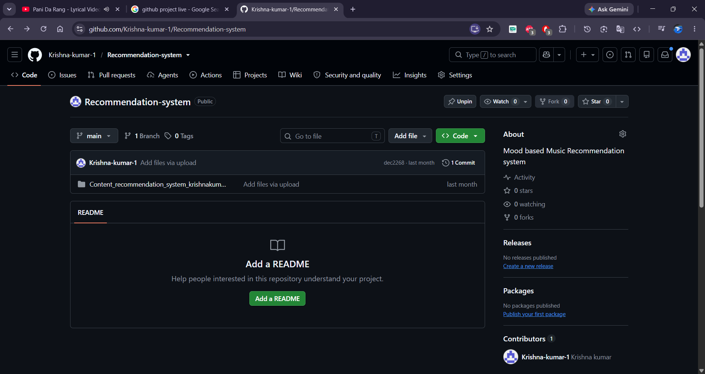

# 🎵 Mood-Based Music Recommendation System

Real-time webcam facial-emotion and hand-gesture detection that recommends personalized music based on your mood and your **past listening history of Actors, Singers, and Languages** — built with **Streamlit**, **MediaPipe Holistic**, **OpenCV**, and **TensorFlow/Keras**.




---

## 🚀 Single-Click App Start

Simply double-click **`Mood Music Recommender`** (the App Start Icon in the folder or on your Desktop), or run:

```bash
python app.py
```

### What Happens Automatically:
1. **Checks Requirements**: Instantly checks if all required packages are installed.
2. **Auto-Installs if Missing**: If requirements are not yet satisfied, it automatically creates an isolated environment and installs all basic and deep-learning dependencies from `requirements.txt`.
3. **Instant Launch & Open**: If requirements are already satisfied, it immediately launches and opens the web application in your browser!

---

## ✨ Key Features

- **🎭 Accurate Multi-Mood Webcam Detection**:
  Combines a **Deep Neural Network (`model.h5`)** with **Scale-Invariant Facial Action Units (FAUs) & Hand Gestures** to accurately detect 9 distinct moods at any camera distance:
  - 😊 **Happy** (Smile / uplifted mouth corners)
  - 😢 **Sad** (Frown / upturned inner brows / droopy mouth / downward gaze)
  - ⚡ **Energy** (Raised hands / high-energy gestures)
  - ❤️ **Romantic** (Warm smile + head tilt)
  - 😮 **Surprised** (Raised eyebrows + open mouth/wide eyes)
  - 😱 **Shocked** (Wide open jaw drop)
  - 😠 **Angry** (Furrowed lowered eyebrows + tense lips)
  - 😔 **Not OK** (Stressed / hand on forehead or face)
  - 😐 **Neutral** (Calm relaxed expression)
- **🌟 Past User History of Actor/Singer & Language**:
  - Automatically remembers your favorite **Actors / Stars & Singers** (e.g., *Shah Rukh Khan, Thalapathy Vijay, Allu Arjun, Prabhas, Salman Khan, Arijit Singh, Anirudh, Sid Sriram, Diljit Dosanjh, The Weeknd*, etc.) and **Languages** (*Hindi, Tamil, Telugu, Punjabi, English, Kannada, Malayalam, Spanish, Korean*) in `data/user_history.json`.
  - Pre-fills your favorite Actor and Language from your past history and dynamically recommends songs matching **Your Current Webcam Mood + Your Past Actor & Language History**!
- **🎧 Multi-Platform Music Playback**:
  - One-click recommendations for **YouTube**, **YouTube Music**, and **Spotify**, plus curated Actor Mood Jukeboxes and Top Mixes.


---

## 📂 Clean Project Structure

```
Mood-music-recommender/
│
├── Mood Music Recommender.lnk    # 🎵 Single App Start Icon (Auto-installs if needed & opens app)
├── app.py                        # 🚀 Unified Smart Launcher + Streamlit Web Application
├── inference.py                  # 👁️ Standalone OpenCV Webcam Emotion Detector
├── train.py                      # 🧠 Neural Network Training Pipeline
├── data_collection.py            # 📹 Webcam Landmark Dataset Recorder
├── model.h5                      # 📦 Trained Keras Emotion Classifier
├── labels.npy                    # 🏷️ Emotion Class Labels
│
├── data/                         # 📁 Landmark Datasets (.npy) & Persistent User History
│   ├── energy.npy
│   ├── happy.npy
│   ├── not_ok.npy
│   ├── sad.npy
│   ├── shocked.npy
│   └── surprised.npy
│
├── assets/                       # 🖼️ Icons, Diagrams & Internal Launch Helper
│   ├── app_icon.ico
│   ├── demo_banner.png
│   ├── emotion_diagram.png
│   └── launch_helper.bat
│
├── requirements.txt              # 📋 Pinned Compatible Dependencies
├── .gitignore                    # 🚫 Git Ignore Configuration
└── LICENSE                       # 📄 MIT License
```

---

## 📄 License

Licensed under the [MIT License](LICENSE).
